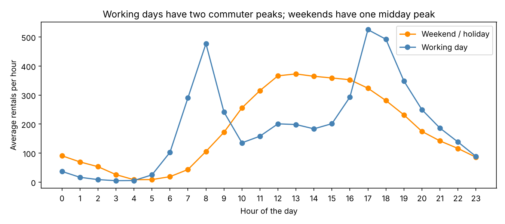
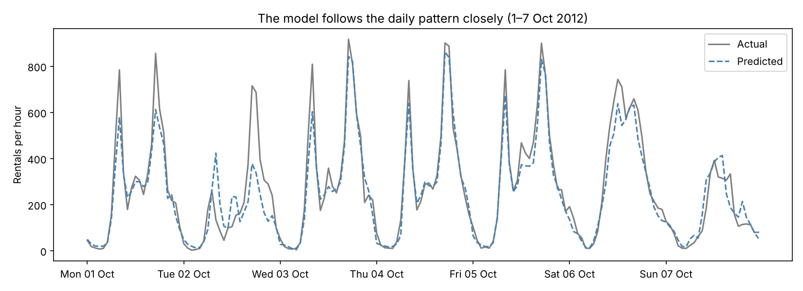
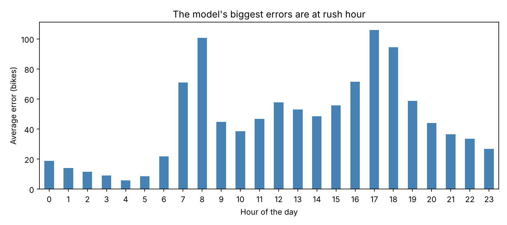

# Bike-Sharing Demand Forecasting

A beginner machine-learning project: predicting **how many bikes will be rented each hour** in Washington DC's bike-sharing scheme, using the time of day, the type of day and the weather.

**Tools:** Python · pandas · matplotlib · scikit-learn

## The question
A bike-sharing company needs bikes at its stations when people want them, and wants to schedule maintenance when demand is low. Can we forecast hourly demand accurately enough to plan around it?

## Data
17,379 hours of rentals from Capital Bikeshare (Washington DC), 2011–2012, with weather for each hour. From Fanaee-T & Gama (2013), originally published in the UCI Machine Learning Repository.

## What I did
1. **Checked the data** and removed two columns that would leak the answer (`casual` + `registered` add up to the target).
2. **Explored** how demand depends on the hour, the type of day, temperature, weather and year.
3. **Split the data by time**: trained on Jan 2011 – Aug 2012 and tested on Sep – Dec 2012, because a forecast must predict the future from the past.
4. **Compared two simple baselines with three models**: linear regression, random forest and gradient boosting.
5. **Used time-series cross-validation** to check stability and tune the best model.
6. **Analysed the errors** by hour, and measured which inputs the model relies on (permutation importance).

## Key findings
- **Two different daily patterns.** Working days have commuter peaks at 8:00 (477 rentals/hour) and 17:00 (525). Weekends have one broad midday peak.
- **Weather matters.** Demand rises from 57 rentals/hour below 0 °C to 326 above 30 °C. Rain or snow roughly halves it.
- **Fast growth.** Average hourly demand rose about 63% from 2011 to 2012.

## Results
Tested on 2,888 hours (Sep–Dec 2012) that the models never saw during training.

| Model | MAE (bikes) ↓ | RMSE ↓ | R² ↑ |
|---|---|---|---|
| Baseline: overall average | 170.5 | 226.0 | −0.08 |
| Baseline: average by hour & day type | 94.8 | 138.5 | 0.60 |
| Linear regression | 97.4 | 132.3 | 0.63 |
| Random forest | 48.1 | 73.5 | 0.89 |
| Gradient boosting | 45.7 | 68.7 | 0.90 |
| **Gradient boosting (tuned)** | **45.0** | **68.1** | **0.90** |

The final model is off by about **45 bikes per hour** on average (test-period average: ~240/hour). That's half the error of the best simple rule.

Its largest errors come at rush hour (about 100 bikes at 8:00 and 17:00). The hour of day is by far its most important input, followed by working day and temperature.

## What I learned
- **For forecasting, split by time, not randomly.** Otherwise the model learns from the future.
- **Baselines keep you honest.** A simple hour-and-day rule already explains 60% of the variation, so the model has to clearly beat that.
- **The right model matters more than tuning.** Tree-based models learn combinations (hour × day type) that linear regression can't. Tuning added only a small gain on top.

## Limitations & next steps
- Two years, one city, total demand only (not per station).
- The model uses actual weather. In real use it would rely on forecasts, which are less accurate.
- Next: add recent demand (e.g. the same hour yesterday), model casual and registered users separately, and focus on improving rush-hour accuracy.

## How to run
Open `Bike_demand_forecasting.ipynb` in [Google Colab](https://colab.research.google.com/) and click *Run all* (about 1–2 minutes). Or locally: `pip install -r requirements.txt`, then `jupyter notebook`.
